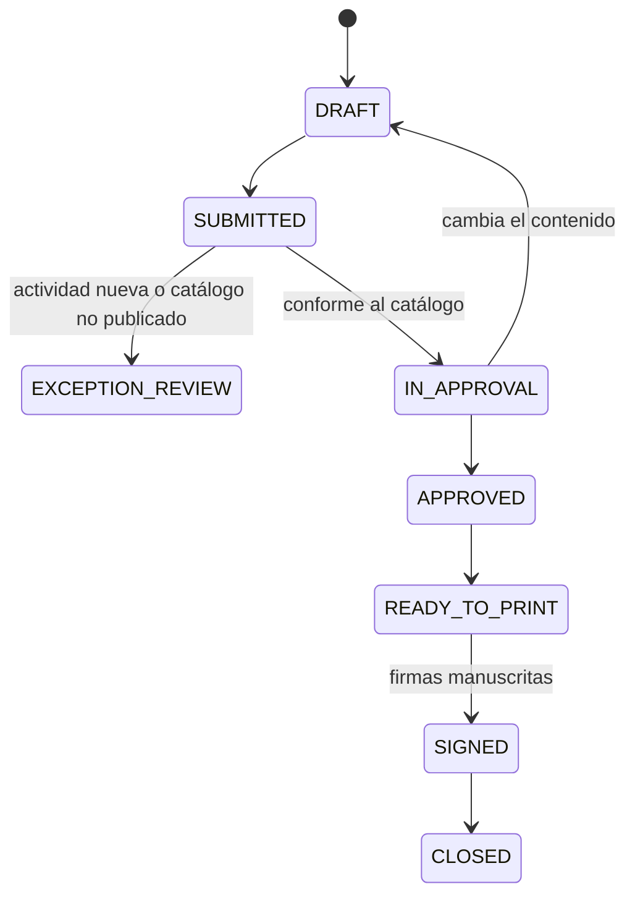

# Arquitectura y seguridad

## Decisión de diseño

El sistema es independiente del de Facilities, aunque puede repetir su patrón operativo. Debe usar la misma cuenta de Google solo como propietaria, pero crear un proyecto Apps Script, una hoja de cálculo y una carpeta de Drive separados.

| Capa | Contenido permitido | Contenido prohibido |
|---|---|---|
| GitHub Pages | HTML, CSS, JavaScript, textos públicos, estructura de formularios | Contraseñas, tokens, IDs privados, DC3, datos personales, respuestas correctas, expedientes |
| Apps Script | Autenticación, permisos, reglas, validación, generación de PDF | Contraseñas en texto claro |
| Google Sheets privado | Catálogos, usuarios, JSA/JRA, decisiones, auditoría | Archivos binarios grandes |
| Google Drive privado | Plantillas oficiales, DC3, materiales, PDF generados | Acceso público permanente |

## Repositorio público o privado

- **Público:** cualquiera puede leer y copiar el código. En GitHub Free permite Pages. Es viable si el repositorio es estrictamente “public-safe”.
- **Privado:** solo colaboradores autorizados ven el código. GitHub Pages desde repositorios privados requiere un plan compatible, y el sitio publicado puede seguir siendo público.
- **Sitio Pages privado:** el control de acceso privado de Pages requiere GitHub Enterprise Cloud.

Recomendación para el piloto: si la cuenta actual es GitHub Free, use repositorio público y trate todo el front-end como información pública. Si KTMEX cuenta con GitHub Pro/Team, use repositorio privado para reducir exposición del código, pero no confíe en ello para proteger datos. En ambos casos, Sheets y Drive permanecen privados.

## Modelo de confianza

El navegador no es confiable. `Code.gs` vuelve a validar:

- sesión y rol;
- estado publicado del catálogo;
- ausencia de excepciones;
- valores válidos de S, F, P y C;
- cálculo de UC y CT;
- riesgo residual bloqueante;
- versión y huella del documento aprobado;
- liberaciones requeridas antes de generar el PDF.

## Identidad sin Google Workspace

El piloto usa usuarios propios con contraseña cifrada mediante hash con sal individual, sesiones de ocho horas y bloqueo después de cinco intentos fallidos. No es SSO. Al obtener Google Workspace, la evolución recomendada es identidad corporativa, MFA y restricción del Web App al dominio.

## Estados de documento

Las liberaciones se revocan automáticamente si cambia el contenido. La aprobación conserva la huella del payload y la versión del catálogo.

