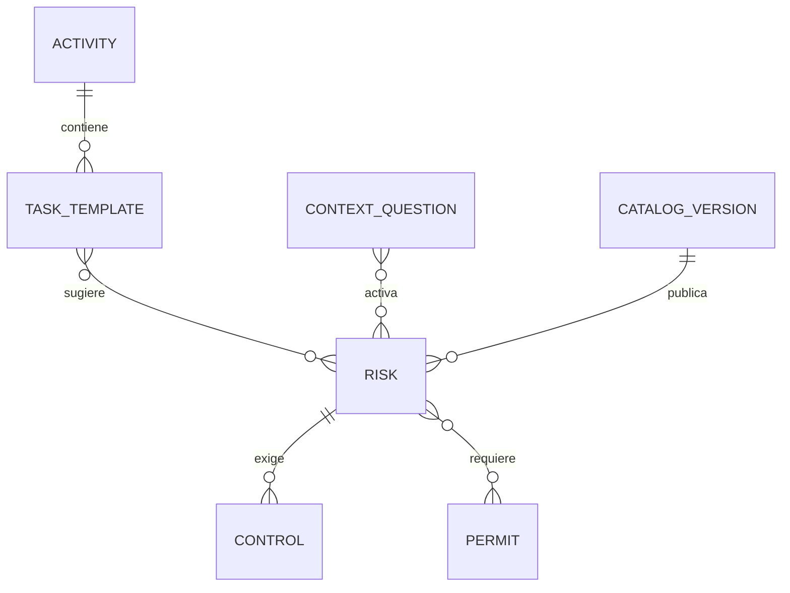

# Modelo de datos

## Catálogo gobernado

La relación mínima es:

Campos obligatorios por riesgo:

| Campo | Uso |
|---|---|
| ID estable | Trazabilidad y no duplicación |
| Tipo | Seguridad o Ambiental |
| Peligro | Fuente o situación con potencial de daño |
| Riesgo/evento peligroso | Suceso que materializa el peligro |
| Consecuencia | Daño creíble |
| Actividad y tarea | Contexto donde aplica |
| Condición disparadora | Respuesta de contexto que lo activa |
| Severidad/probabilidad JSA | Valores del formato F-SGA-8.1-7 |
| Categoría y S/F/P JRA | Valores del KQMS-SA-FO-015 |
| Controles | Texto, jerarquía, obligatoriedad y evidencia |
| Documentos | Permiso, inspección, MOE, HDS, DC3 u otro |
| Propietario | Safety o Ambiental |
| Estado/versión | DRAFT, REVIEW, PUBLISHED o RETIRED |

## Documentos transaccionales

JSA y JRA conservan:

- folio e ID inmutable;
- versión del catálogo;
- payload completo;
- huella SHA-256 del payload;
- creador y fechas;
- bandera de excepción;
- aprobaciones vinculadas a la huella;
- bitácora de cambios y generación.

## DC3

El módulo solo verifica. Registra persona, empresa, ID, curso/competencia, agente capacitador, folio, emisión, vigencia si aplica, archivo privado, huella, estatus, revisor, fecha y motivo. No genera un DC3.

## Cursos y exámenes

Las preguntas y respuestas correctas se almacenan en el backend. El front-end recibe una pregunta por vez y envía la respuesta; no debe descargar el banco completo. El piloto local demuestra la navegación, no la seguridad de un examen productivo.

